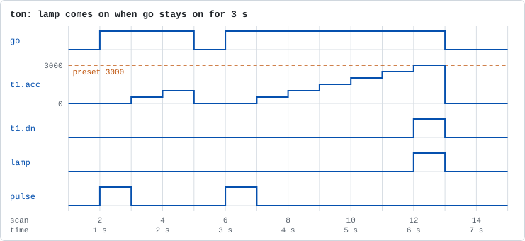
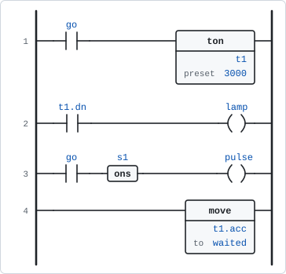
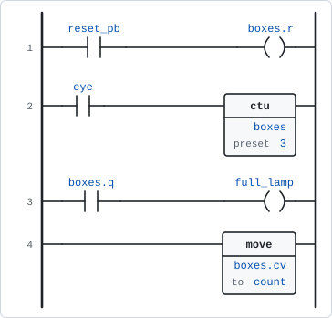
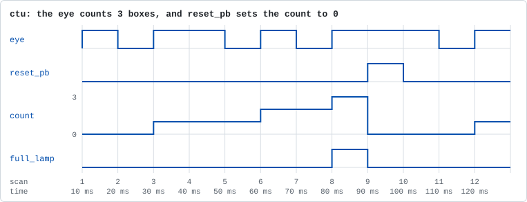

# A timer and a counter

This tutorial is for an Elixir developer who did the tutorial
[Your first program](first-program.md). You write a program with a timer and a program
with a counter. You run each program from a script.

You learn how a [timer](../reference/glossary.md#timer) measures time and how a
[counter](../reference/glossary.md#counter) counts. You also see that the
[host](../reference/glossary.md#host), which is your script, gives the time to each
[scan](../reference/glossary.md#scan).

## What you make

You make 2 [programs](../reference/glossary.md#program). You also make 1 script for each
program.

| Program | What it does | Script |
|---|---|---|
| `delay.ld` | A lamp comes on when the [input](../reference/glossary.md#input) `go` stays on for 3 s. | `delay.exs` |
| `boxes.ld` | It counts the boxes on a conveyor. A lamp comes on at 3 boxes. | `boxes.exs` |

This timing diagram shows what `delay.ld` does. Time goes from left to right, and each
column is 1 scan of 500 ms. The row `t1.acc` is the time that the timer measures. The
first time, `go` is on for 3 scans only, and the lamp stays off. The second time, `go`
comes on in scan 6 and stays on. The lamp comes on in scan 12, which is 3 s later.

<!-- timing: delay.timing.exs -->


[Step 1](#step-1-write-the-timer-program) gives the other 2 rows, `t1.dn` and `pulse`.
[Step 4](#step-4-run-the-counter-program) shows a diagram of the same kind for `boxes.ld`.

## Before you start

You must have the project of [Your first program](first-program.md): the directory
`first` with its file `mix.exs`. Do each step of this tutorial in that directory.

## Step 1: Write the timer program

Make the file `delay.ld` with this text:

<!-- file: delay.ld -->
```text
var_input go bool
var_output lamp bool
var_output pulse bool
var_output waited dint
var t1 ton
var s1 bool

xic go ton t1 3000
xic t1.dn ote lamp
xic go ons s1 ote pulse
move t1.acc waited
```

This drawing shows the 4 [rungs](../reference/glossary.md#rung) of the program. The box
in rung 1 is the timer.

<!-- rung: delay.ld -->


The word `ton` is a type in the [declaration](../reference/glossary.md#declaration) and
an [instruction](../reference/glossary.md#instruction) in rung 1. The program has 4 new
parts:

| Text | What it does |
|---|---|
| `var t1 ton` | It declares the timer `t1`. The [type](../reference/glossary.md#type) `ton` is an on-delay timer. |
| `ton t1 3000` | It gives the timer `t1` a [preset](../reference/glossary.md#preset) of 3000 ms. While rung 1 is [true](../reference/glossary.md#true-rung), the timer measures the time. If rung 1 is [false](../reference/glossary.md#false-rung), the timer goes back to 0. |
| `t1.acc` and `t1.dn` | They are 2 [members](../reference/glossary.md#member) of the timer. `t1.acc` holds the time since the timer started, in ms, up to the preset. `t1.dn` is 1 when `t1.acc` is equal to the preset. |
| `ons s1` | It is a [one-shot](../reference/glossary.md#one-shot). It passes power for 1 scan when `go` changes from 0 to 1. The bool [tag](../reference/glossary.md#tag) `s1` is its [storage bit](../reference/glossary.md#storage-bit). |

Rung 4 has no [contact](../reference/glossary.md#contact). Thus `move` gets power in
each scan. It copies `t1.acc` to the [output](../reference/glossary.md#output) `waited`.

The lamp has a separate rung, because no instruction can come after a `ton` and get its
power from it.

## Step 2: Run the timer program

> #### The host gives the time {: .info}
>
> `Logex.Runtime` reads no clock. Your script tells each scan how much time it gets. Thus
> the script does not wait for 3 s, and each run prints the same lines.
>
> `Logex.Runtime.scan/2`, which the first tutorial uses, gives 0 ms to a scan. With that
> call, a timer measures no time.

Make the file `delay.exs` with this text. The first argument of each `scan.` call is the
time for that scan, in ms. The script gives it to `Logex.Runtime.scan/3` as the third
argument. Copy the spaces at the end of each string. They make the columns of the output.

```elixir
{:ok, delay} = Logex.compile_file("delay.ld")

scan = fn state, elapsed, label, inputs ->
  state = Logex.Runtime.put_inputs(delay, state, inputs)
  {outputs, state} = Logex.Runtime.scan(delay, state, elapsed)
  IO.puts("t=#{String.pad_leading("#{state.now}", 4)}  #{label}  #{inspect(outputs)}")
  state
end

Logex.Runtime.instance(delay)
|> scan.(0, "idle      ", %{})
|> scan.(100, "go on     ", %{"go" => 1})
|> scan.(1000, "held      ", %{})
|> scan.(2000, "held      ", %{})
|> scan.(500, "held      ", %{})
|> scan.(10, "go off    ", %{"go" => 0})
```

Run the script:

```console
$ mix run delay.exs
t=   0  idle        %{"lamp" => 0, "pulse" => 0, "waited" => 0}
t= 100  go on       %{"lamp" => 0, "pulse" => 1, "waited" => 0}
t=1100  held        %{"lamp" => 0, "pulse" => 0, "waited" => 1000}
t=3100  held        %{"lamp" => 1, "pulse" => 0, "waited" => 3000}
t=3600  held        %{"lamp" => 1, "pulse" => 0, "waited" => 3000}
t=3610  go off      %{"lamp" => 0, "pulse" => 0, "waited" => 0}
```

If you see these 6 lines, the program and the script are correct.

> #### If you see a `MatchError` {: .info}
>
> The text after `MatchError` shows a [diagnostic](../reference/glossary.md#diagnostic).
> Read its fields `line:` and `message:`.
>
> If `line:` is a number, compare that line of `delay.ld` with Step 1. Correct it, and
> run the script again.
>
> If `line:` is `nil`, the script cannot read `delay.ld`. Make sure that the file is in
> the directory `first`.

Each scan adds its time to `state.now`, which is the time of the
[instance](../reference/glossary.md#instance) in ms. Each line starts with that value,
after `t=`.

| Line | Scan gets | What the scan does |
|---|---|---|
| `t=   0` | 0 ms | `go` is 0. Rung 1 is false, and the timer measures no time. |
| `t= 100` | 100 ms | `go` is 1. The timer starts at this scan. Thus `waited` is 0. The one-shot passes power, and `pulse` is 1 for this scan only. |
| `t=1100` | 1000 ms | `waited` is 1000. |
| `t=3100` | 2000 ms | `waited` is 3000, which is the preset. `t1.dn` is 1, and the lamp comes on. |
| `t=3600` | 500 ms | The timer stops at its preset. `waited` stays 3000. |
| `t=3610` | 10 ms | `go` is 0. Rung 1 is false, the timer goes back to 0, and the lamp goes off. |

The timer measures time. It does not count scans. In this run, the lamp comes on 2 scans
after the timer starts, because those 2 scans get 1000 ms and 2000 ms. In the timing
diagram of [What you make](#what-you-make), each scan gets 500 ms. There, the timer
starts in scan 6 and the lamp comes on in scan 12, which is 6 scans later.

## Step 3: Write the counter program

The second program is for a conveyor that carries boxes to a case. A case holds 3 boxes.
A photo-eye is a sensor. The input `eye` is 1 while a box is in front of the photo-eye.

The program counts the boxes that go past the photo-eye. At 3 boxes the case is full, and
the lamp `full_lamp` comes on. The button `reset_pb` sets the count to 0 for the next
case.

Make the file `boxes.ld` with this text:

<!-- file: boxes.ld -->
```text
var_input eye bool
var_input reset_pb bool
var_output full_lamp bool
var_output count dint
var boxes ctu

xic reset_pb ote boxes.r
xic eye ctu boxes 3
xic boxes.q ote full_lamp
move boxes.cv count
```

This drawing shows the 4 rungs of the program. The box in rung 2 is the counter.

<!-- rung: boxes.ld -->


The word `ctu` is a type in the declaration and an instruction in rung 2. The program
has 5 new parts:

| Text | What it does |
|---|---|
| `var boxes ctu` | It declares the counter `boxes`. The type `ctu` is an up counter. |
| `ctu boxes 3` | It gives the counter `boxes` a preset of 3. The counter adds 1 to `boxes.cv` each time `eye` changes from 0 to 1, which is a [rising edge](../reference/glossary.md#rising-edge). |
| `boxes.cv` | This member holds the count. |
| `boxes.q` | This member is 1 when `boxes.cv` is equal to the preset or more. |
| `boxes.r` | This member is the reset input of the counter. While it is 1, the counter keeps `boxes.cv` at 0. |

Rung 1 writes the member `boxes.r` with a [coil](../reference/glossary.md#coil), as a
rung writes a bool tag. Rung 3 reads `boxes.q`, because no instruction can come after a
`ctu` and get its power from it.

## Step 4: Run the counter program

Make the file `boxes.exs` with this text:

```elixir
{:ok, boxes} = Logex.compile_file("boxes.ld")

scan = fn state, label, inputs ->
  state = Logex.Runtime.put_inputs(boxes, state, inputs)
  {outputs, state} = Logex.Runtime.scan(boxes, state, 10)
  IO.puts("#{label}  #{inspect(outputs)}")
  state
end

Logex.Runtime.instance(boxes)
|> scan.("box on the eye at start", %{"eye" => 1})
|> scan.("eye clear              ", %{"eye" => 0})
|> scan.("box 1                  ", %{"eye" => 1})
|> scan.("still box 1            ", %{})
|> scan.("eye clear              ", %{"eye" => 0})
|> scan.("box 2                  ", %{"eye" => 1})
|> scan.("eye clear              ", %{"eye" => 0})
|> scan.("box 3                  ", %{"eye" => 1})
|> scan.("reset, box on the eye  ", %{"reset_pb" => 1})
|> scan.("reset let go           ", %{"reset_pb" => 0})
|> scan.("eye clear              ", %{"eye" => 0})
|> scan.("box 1 of the next case ", %{"eye" => 1})
```

Run the script:

```console
$ mix run boxes.exs
box on the eye at start  %{"count" => 0, "full_lamp" => 0}
eye clear                %{"count" => 0, "full_lamp" => 0}
box 1                    %{"count" => 1, "full_lamp" => 0}
still box 1              %{"count" => 1, "full_lamp" => 0}
eye clear                %{"count" => 1, "full_lamp" => 0}
box 2                    %{"count" => 2, "full_lamp" => 0}
eye clear                %{"count" => 2, "full_lamp" => 0}
box 3                    %{"count" => 3, "full_lamp" => 1}
reset, box on the eye    %{"count" => 0, "full_lamp" => 0}
reset let go             %{"count" => 0, "full_lamp" => 0}
eye clear                %{"count" => 0, "full_lamp" => 0}
box 1 of the next case   %{"count" => 1, "full_lamp" => 0}
```

If you see these 12 lines, the program and the script are correct. If you see a
`MatchError`, do what [Step 2](#step-2-run-the-timer-program) says, for `boxes.ld`.

Each line is 1 scan. The script gives 10 ms to each scan, but a counter does not use the
time. This timing diagram shows the same 12 scans.

<!-- timing: timers-and-counters-boxes.timing.exs -->


| Scan | Line | What you see |
|---|---|---|
| 1 | `box on the eye at start` | A box is in front of the photo-eye when the program starts. The counter does not count on the [first scan](../reference/glossary.md#first-scan). |
| 3 and 4 | `box 1` and `still box 1` | Box 1 adds 1 to the count. While box 1 stays in front of the photo-eye, the count does not change. |
| 8 | `box 3` | Box 3 makes the count equal to the preset. The lamp comes on. |
| 9 | `reset, box on the eye` | The button sets the count to 0, and the lamp goes off. |
| 10 to 12 | `reset let go` to `box 1 of the next case` | Box 3 is in front of the photo-eye during the reset. The counter does not count it again. The next box is box 1 of the next case. |

## What you learned

- You declare a [timer](../reference/glossary.md#timer) or a
  [counter](../reference/glossary.md#counter) with `var` and its type. You read its
  [members](../reference/glossary.md#member) with a dot.
- A [`ton`](../reference/instructions-timers-and-counters.md) measures time while its
  rung is true. Its member `dn` is 1 at the [preset](../reference/glossary.md#preset). If
  the rung is false, the timer goes back to 0.
- The [host](../reference/glossary.md#host) gives the time. It is the third argument of
  `Logex.Runtime.scan/3`.
- An `ons` is a [one-shot](../reference/glossary.md#one-shot). It passes power for 1 scan
  at a [rising edge](../reference/glossary.md#rising-edge).
- A [`ctu`](../reference/instructions-timers-and-counters.md) counts rising edges. Its
  member `q` is 1 when the count is equal to the preset or more. Its member `r` sets the
  count to 0.

## See also

- [Your first plant](first-plant.md): the next tutorial. It puts 2 programs on
  [tasks](../reference/glossary.md#task) in a
  [configuration file](../reference/glossary.md#configuration-file).
- [Use timers](../howto/use-timers.md), [Use counters](../howto/use-counters.md) and
  [Use one-shots and pulse coils](../howto/use-one-shots-and-pulse-coils.md): the other
  timers, counters and one-shots.
- [Instructions: timers and counters](../reference/instructions-timers-and-counters.md)
  and [Function blocks](../reference/function-blocks.md): the exact rules and each
  member.
- [The scan, the cycle and time](../explanation/scan-cycle-and-time.md): why the host
  gives the time.
- [Run a plant on the clock](../howto/run-on-the-clock.md): the
  [runner](../reference/glossary.md#runner), which reads the clock of the machine.
